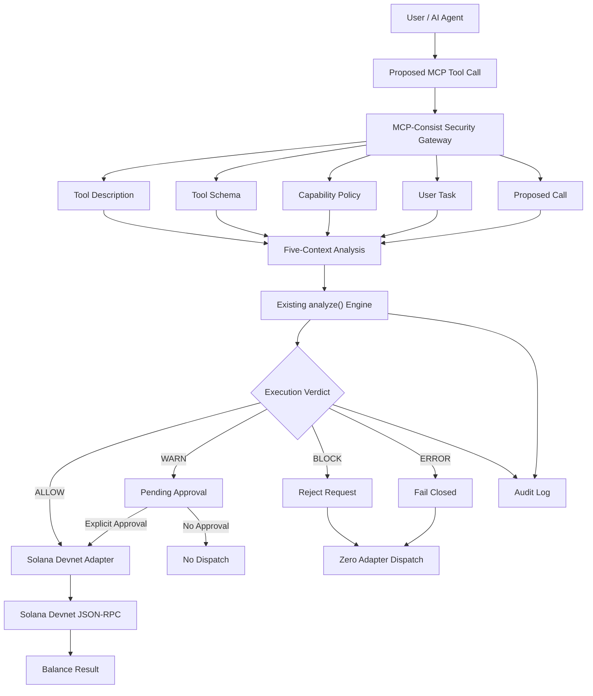

# MCP-Consist — Pre-Execution Security Gateway for AI Agent Tool Calls

**A context-aware security gateway that evaluates MCP tool calls across five security contexts before execution, demonstrated through a read-only Solana Devnet integration.**

[](https://www.python.org/)
[](https://modelcontextprotocol.io/)
[](https://solana.com/)
[](https://fastapi.tiangolo.com/)
[](#testing)
[](https://mcp-consist-solana.onrender.com)

<p align="center">
  <a href="https://mcp-consist-solana.onrender.com"><strong>Live Web Demo</strong></a>
  &nbsp; | &nbsp;
  <a href="https://youtu.be/wjIaX1jvCbM"><strong>Demo Video</strong></a>
  &nbsp; | &nbsp;
  <a href="https://github.com/umairs759/mcp-consist"><strong>Original Research Engine</strong></a>
</p>

---

## Table of Contents

- [Overview](#overview)
- [The Security Problem](#the-security-problem)
- [Core Approach: Five-Context Evaluation](#core-approach-five-context-evaluation)
- [Architecture](#architecture)
- [Decision and Enforcement Model](#decision-and-enforcement-model)
- [Solana Devnet Integration](#solana-devnet-integration)
- [MCP Server](#mcp-server)
- [Browser Demonstration](#browser-demonstration)
- [Audit Logging](#audit-logging)
- [Technology Stack](#technology-stack)
- [Project Structure](#project-structure)
- [Getting Started](#getting-started)
- [Running the Project](#running-the-project)
- [Environment Configuration](#environment-configuration)
- [Testing](#testing)
- [Render Deployment](#render-deployment)
- [Security Considerations and Limitations](#security-considerations-and-limitations)
- [Research Background and Attribution](#research-background-and-attribution)

---

## Overview

MCP-Consist is a context-aware security gateway designed to evaluate tool execution requests made by AI agents before they reach an underlying tool or service.

The project focuses on a security challenge in Model Context Protocol (MCP) environments: a tool call cannot always be evaluated safely by inspecting its description, schema, or arguments independently.

A request may appear technically valid while conflicting with the user's actual task or the capabilities permitted by the security policy.

MCP-Consist addresses this problem through a five-context evaluation process.

Before execution, the gateway evaluates:

1. Tool description
2. Tool schema
3. Capability policy
4. User task
5. Proposed tool call

The existing detection engine analyzes these contexts and produces an execution decision:

- **ALLOW** — The request is permitted to proceed.
- **WARN** — The request requires explicit approval.
- **BLOCK** — The request is rejected before execution.
- **ERROR** — Analysis failures and unknown outcomes are handled fail-closed.

This submission demonstrates the approach through a real, read-only Solana Devnet balance lookup using the `solana_get_balance(address)` MCP tool.

The project includes an MCP stdio server, a Solana JSON-RPC adapter, an enforcement gateway, a CLI demonstration, and a browser-based demonstration deployed on Render.

## The Security Problem

MCP allows AI applications and agents to interact with external tools and services.

However, tool availability does not automatically establish that every proposed invocation is appropriate for the user's task or authorized by the application's capability policy.

Consider the following example:

**User task:**

> Check the SOL balance of this account.

**Proposed tool operation:**

> Execute a token transfer.

The proposed operation does not match the user's requested task.

A security mechanism that merely checks whether the tool exists or whether its arguments are structurally valid may miss this contextual conflict.

MCP-Consist places a security evaluation layer between a proposed tool invocation and its execution adapter.

Its objective is to make the decision before the underlying operation is dispatched.

The Solana integration provides a concrete demonstration of this enforcement boundary using a read-only blockchain operation.

## Core Approach: Five-Context Evaluation

The gateway constructs a structured evaluation context containing five inputs.

| Context | Purpose |
|---|---|
| Tool Description | Defines what the tool is intended to do. |
| Tool Schema | Describes the accepted arguments and input structure. |
| Capability Policy | Specifies permitted tools, actions, and execution boundaries. |
| User Task | Represents the operation requested by the user. |
| Proposed Tool Call | Contains the actual proposed tool name, action, and arguments. |

These inputs are passed to the existing `analyze()` function in the MCP-Consist detection engine.

The engine evaluates the request and returns a structured analysis result containing a verdict and associated findings.

The gateway then enforces that decision before allowing the adapter to execute.

Importantly, the five-context evaluation is performed using the existing deterministic, rule-based engine. It is not an LLM-generated security verdict.

## Architecture



### Main Components

**1. Detection Engine — `mcp_consist/`**

Contains the existing MCP-Consist detection engine, including configuration, normalization, validation, rule execution, analysis models, and reporting functionality.

The engine is included unchanged from the pre-existing research project.

**2. Security Gateway — `gateway.py`**

Acts as the enforcement layer between security analysis and the Solana execution adapter.

Responsibilities include:

- Constructing all five evaluation contexts.
- Invoking the existing `analyze()` function.
- Enforcing ALLOW, WARN, BLOCK, and ERROR outcomes.
- Managing pending WARN approvals.
- Preventing blocked requests from reaching the adapter.
- Recording execution decisions in the audit log.

**3. MCP Server — `server.py`**

Implements the read-only MCP tool using the official Python MCP SDK.

It exposes the `solana_get_balance(address)` tool over standard input/output transport.

**4. Solana Adapter — `gateway.py`**

Implements the read-only Solana Devnet JSON-RPC request using the `getBalance` method.

The adapter validates addresses, applies request timeouts, handles RPC errors, and tracks adapter dispatches.

**5. CLI Demonstration — `demo.py`**

Provides command-line scenarios to demonstrate gateway decisions and execution behavior.

**6. Browser Application — `webapp.py`**

Provides a browser-accessible demonstration through FastAPI.

It uses the same security gateway and exposes a limited set of predefined demonstration scenarios.

---

## Decision and Enforcement Model

The security gateway enforces the engine's decision before the proposed operation reaches the adapter.

| Verdict | Gateway Behavior | Adapter Execution |
|---|---|---|
| ALLOW | Permit the authorized balance request. | Executed |
| WARN | Store a pending request and require approval. | Paused until approval |
| BLOCK | Reject the proposed operation. | Never dispatched |
| ERROR | Fail closed when analysis fails or produces an invalid outcome. | Never dispatched |

### ALLOW — Permitted Execution

When the existing engine produces ALLOW, the gateway dispatches the approved balance request to the Solana Devnet adapter.

The adapter performs a real `getBalance` JSON-RPC request and returns the balance in lamports and SOL.

### WARN — Human Approval Required

When the engine produces WARN, the gateway generates an approval identifier and stores a pending request.

The adapter is not called at this stage.

Execution can proceed through the gateway's explicit approval method:

```python
result = gateway.approve(approval_id)
```

The pending request is consumed during approval, and the operation is revalidated before dispatch.

The MCP stdio interface returns an approval-required result and an approval identifier. It does not expose a separate MCP approval tool.

### BLOCK — Execution Prevented

When the engine produces BLOCK, the gateway rejects the request.

The underlying Solana adapter is never called.

The central demonstration is:

```text
Security Verdict: BLOCK
Adapter Dispatch Count: 0
Execution: DENIED
```

This demonstrates enforcement before adapter dispatch rather than merely reporting a security warning after execution.

### ERROR — Fail-Closed Behavior

If analysis raises an exception, produces an unknown verdict, or otherwise cannot establish an acceptable execution decision, the gateway denies execution.

No adapter dispatch is permitted for an ERROR outcome.

---

## Solana Devnet Integration

The blockchain integration is intentionally limited to one read-only operation:

```text
solana_get_balance(address)
```

The integration communicates with Solana through its JSON-RPC interface.

**Default endpoint:**

```text
https://api.devnet.solana.com
```

**RPC method:**

```text
getBalance
```

**Example JSON-RPC request:**

```json
{
  "jsonrpc": "2.0",
  "id": 1,
  "method": "getBalance",
  "params": [
    "ACCOUNT_PUBLIC_KEY"
  ]
}
```

The adapter processes the returned balance and provides:

- Solana account address
- Balance in lamports
- Balance in SOL
- RPC context information when returned by the endpoint

### Address Validation

Before execution, the gateway validates the supplied Solana public key.

Validation includes:

- Base58 alphabet verification.
- Decoding the public key.
- Requiring an exact decoded length of 32 bytes.

Malformed addresses are rejected before adapter dispatch.

### RPC Safety

The adapter includes:

- HTTPS endpoint validation.
- Request timeouts.
- RPC error handling.
- Response structure validation.
- Adapter dispatch tracking.

The default capability policy restricts the permitted read operation to the configured Solana Devnet context.

No private keys or wallet signing mechanisms are included.

No transactions or transfers are implemented.

No Solana Mainnet operations are part of this demonstration.

---

## MCP Server

The project implements an MCP server through the official Python MCP SDK.

The server exposes one read-only tool:

```text
solana_get_balance(address)
```

The tool is designed to retrieve the balance of a Solana account through the security gateway.

### Tool Interface

| Property | Value |
|---|---|
| Tool Name | `solana_get_balance` |
| Input | Solana account address |
| Input Type | String |
| Operation | Read-only |
| Network | Solana Devnet |
| Transport | MCP stdio |

Every proposed operation passes through the security gateway before the adapter can execute it.

The MCP server and the browser application are separate interfaces to the same gateway logic.

The browser application is not an MCP-over-HTTP transport implementation.

---

## Browser Demonstration

**Live Application:** https://mcp-consist-solana.onrender.com

The browser interface provides a visual way to explore the security enforcement workflow.

It uses the existing gateway and predefined scenarios rather than independently implementing a second security engine.

### Demonstration Scenarios

**1. Legitimate Balance Lookup**

Demonstrates an authorized request to retrieve an account balance.

Expected behavior:

- Evaluate all five security contexts.
- Obtain the engine's verdict.
- Dispatch an allowed request.
- Retrieve the actual balance from Solana Devnet.

**2. Unauthorized Operation**

Demonstrates a proposed operation that conflicts with a balance-only user task.

Expected behavior:

- Evaluate the proposed request.
- Display the engine's BLOCK verdict when produced.
- Prevent adapter execution.
- Display the per-request adapter dispatch count.

The key security evidence is zero adapter dispatches for the blocked request.

**3. Approval-Required Request**

Demonstrates a WARN outcome.

Expected behavior:

- Generate a pending approval identifier.
- Keep the request unexecuted.
- Require explicit approval before dispatch.
- Display the execution result after approval.

### Browser Health Check

The application exposes:

```text
GET /health
```

The browser application can be accessed through the public Render deployment.

**Note:** The browser demonstration calls the gateway directly in the web application process. It is not an external MCP-over-HTTP client.

---

## Audit Logging

The gateway records execution decisions in a JSON Lines audit file.

The default audit file is:

```text
audit.jsonl
```

Each audit record includes information such as:

- Security decision
- Associated findings
- Whether the adapter was executed
- Approval identifier when applicable
- Additional error information when relevant

Audit records are useful for inspecting the enforcement sequence and understanding why a request was allowed, paused, or rejected.

The audit file uses the host filesystem. Hosted filesystem persistence depends on the deployment configuration.

---

## Technology Stack

| Technology | Purpose |
|---|---|
| Python | Core implementation |
| Model Context Protocol (MCP) | Standardized tool interface |
| Official Python MCP SDK | MCP server implementation |
| FastAPI | Browser application |
| Uvicorn | ASGI application server |
| Solana Devnet | Blockchain demonstration environment |
| JSON-RPC | Solana balance retrieval |
| pytest | Automated testing |
| Git & GitHub | Source code management |
| Render | Public web application hosting |

The detection engine is deterministic and rule-based.

The submitted implementation does not call Gemini, OpenAI, Claude, or another external LLM API to generate security verdicts.

---

## Project Structure

```text
mcp-consist-solana/
│
├── mcp_consist/
│   ├── __init__.py
│   ├── config.py
│   ├── engine.py
│   ├── models.py
│   ├── normalization.py
│   ├── reporting.py
│   ├── rules.py
│   └── validation.py
│
├── tests/
│   ├── test_devnet.py
│   ├── test_gateway.py
│   ├── test_mcp_invocation.py
│   ├── test_mcp_transport.py
│   └── test_webapp.py
│
├── gateway.py
├── server.py
├── webapp.py
├── demo.py
├── requirements.txt
├── README.md
└── audit.jsonl
```

### Important Files

| File | Responsibility |
|---|---|
| `gateway.py` | Five-context evaluation enforcement and Solana adapter |
| `server.py` | Official Python MCP stdio server |
| `webapp.py` | Browser demonstration and HTTP interface |
| `demo.py` | Command-line security scenarios |
| `mcp_consist/` | Existing detection engine |
| `tests/` | Gateway, MCP, Devnet, and browser application tests |
| `requirements.txt` | Python dependencies |
| `audit.jsonl` | Local JSONL execution audit |

---

## Getting Started

### Prerequisites

- Python 3.14 (the version used for the reported local verification)
- Git
- Internet connectivity for Solana Devnet requests
- A Solana account public key for balance lookup

No private key, funded wallet, or blockchain transaction is required.

### 1. Clone the Repository

```bash
git clone https://github.com/umairs759/mcp-consist-solana.git

cd mcp-consist-solana
```

### 2. Create a Virtual Environment

Linux/macOS:

```bash
python -m venv .venv

source .venv/bin/activate
```

Windows:

```powershell
python -m venv .venv

.venv\Scripts\activate
```

### 3. Install Dependencies

```bash
pip install -r requirements.txt
```

---

## Running the Project

### Run the MCP Server

```bash
python server.py
```

The MCP server runs over standard input/output transport and exposes the read-only `solana_get_balance(address)` tool.

It is intended to be launched by a compatible MCP client.

### Run the CLI Demonstration

```bash
python demo.py
```

The CLI demonstration exercises the gateway scenarios.

The legitimate balance lookup makes a real Devnet request when the network is available.

The security scenarios demonstrate the gateway's ALLOW, WARN, and BLOCK enforcement behavior.

### Run the Browser Application

```bash
uvicorn webapp:app --host 0.0.0.0 --port 8000
```

Open:

```text
http://localhost:8000
```

The browser interface uses the same gateway implementation as the CLI demonstration.

---

## Environment Configuration

The following environment variables are supported by the implementation.

| Variable | Purpose | Default |
|---|---|---|
| `SOLANA_RPC_URL` | Solana RPC endpoint | `https://api.devnet.solana.com` |
| `MCP_CONSIST_AUDIT_LOG` | Audit log file location | `audit.jsonl` |
| `PORT` | Web application listening port | Deployment-provided |

Example:

```bash
export SOLANA_RPC_URL="https://api.devnet.solana.com"

export MCP_CONSIST_AUDIT_LOG="audit.jsonl"
```

The configured RPC endpoint must satisfy the adapter's HTTPS and endpoint restrictions. The default policy is designed around the public Devnet endpoint.

Never place private keys, wallet credentials, or other secrets in public configuration files.

---

## Testing

The project includes automated tests covering the gateway, MCP implementation, browser interface, and Solana integration.

### Run the Complete Test Suite

```bash
python -m pytest -q
```

### Run Specific Test Groups

Gateway tests:

```bash
python -m pytest -q tests/test_gateway.py
```

Solana Devnet smoke test:

```bash
python -m pytest -q tests/test_devnet.py
```

MCP SDK invocation:

```bash
python -m pytest -q tests/test_mcp_invocation.py
```

MCP stdio transport:

```bash
python -m pytest -q tests/test_mcp_transport.py
```

Browser application:

```bash
python -m pytest -q tests/test_webapp.py
```

The Devnet smoke test requires network access. The deterministic gateway and browser tests use mocked adapters for controlled execution checks.

### Latest Reported Local Verification

The expanded test suite was run after the browser application was added.

| Check | Result |
|---|---|
| Python web application import | Passed |
| FastAPI application initialization | Passed |
| Automated tests | 13 passed |
| Failed tests | 0 |
| Test warnings | 1 |
| Git staged diff whitespace check | Passed |
| Render deployment | Live |

The reported test warning concerns the deprecation of using `httpx` with Starlette's `TestClient`; it did not cause the test suite to fail.

These results describe the local verification run. They should not be interpreted as proof of continuous production monitoring or a guarantee that external RPC services are always available.

---

## Render Deployment

The browser demonstration is hosted as a Render Web Service.

**Live URL:**

https://mcp-consist-solana.onrender.com

### Deployment Configuration

Build Command:

```bash
pip install -r requirements.txt
```

Start Command:

```bash
uvicorn webapp:app --host 0.0.0.0 --port $PORT
```

Health Check Path:

```text
/health
```

The application binds to `0.0.0.0` and uses the port provided by the hosting environment.

### Deployment Information

| Property | Value |
|---|---|
| Hosting Platform | Render |
| Application | FastAPI |
| ASGI Server | Uvicorn |
| Deployment Source | GitHub |
| Branch | `master` |
| Verified Deployment Commit | `668ac4a` |
| Status at documented deployment | Live |

The public service may experience cold starts, temporary unavailability, or other hosting limitations depending on the Render instance configuration.

---

## Security Considerations and Limitations

MCP-Consist is a research prototype. It is not a production security boundary or a certification of safe AI-agent execution.

The following limitations are important:

**1. Deterministic Detection**

The current engine uses deterministic, rule-based analysis. It does not use an LLM to make security decisions and does not guarantee detection of every malicious or unauthorized tool call.

**2. Limited Tool Scope**

The demonstration focuses on one read-only Solana balance operation. It does not provide a general-purpose security gateway for every MCP tool.

**3. Schema Validation**

The detection engine does not provide complete JSON Schema validation. Input validation is implemented for the specific balance tool.

**4. Approval State**

Pending approval requests are stored in application memory. They are not designed for durable, distributed, multi-instance approval workflows.

**5. Audit Persistence**

Audit records are written to a JSONL file on the host filesystem. Hosted filesystem persistence may be ephemeral.

**6. MCP Transport**

The MCP server uses stdio transport. The browser interface directly invokes the gateway and is not an MCP-over-HTTP client.

**7. External RPC Dependency**

Balance retrieval depends on the availability and response behavior of Solana Devnet.

**8. Security Scope**

This prototype does not implement wallet signing, transaction submission, transfers, private-key management, or Solana Mainnet access.

The implementation is intended to demonstrate pre-execution security analysis and enforcement in a controlled, read-only integration.

---

## Research Background and Attribution

### Pre-existing Research Engine Disclosure

The core MCP-Consist detection engine predates the Solana Hackathon.

It is available in the original research repository:

**Original Repository:**  
https://github.com/umairs759/mcp-consist

The `mcp_consist/` package in this submission is included from that existing project unchanged.

### Work Added for This Demonstration

The separate Solana hackathon repository adds:

- A gateway connecting the existing engine to an execution adapter.
- An MCP server using the official Python MCP SDK.
- A read-only Solana Devnet `getBalance` adapter.
- ALLOW, WARN, BLOCK, and fail-closed ERROR enforcement.
- Pending approval handling for WARN decisions.
- Adapter dispatch tracking and JSONL audit logging.
- CLI demonstration scenarios.
- A FastAPI browser demonstration.
- Tests for the new gateway, MCP, and browser integration.

The implementation is intentionally documented as a combination of pre-existing research work and new integration work rather than presenting the entire detection engine as newly created during the event.

---

## Project Links

| Resource | Link |
|---|---|
| Hackathon Implementation | https://github.com/umairs759/mcp-consist-solana |
| Original Research Engine | https://github.com/umairs759/mcp-consist |
| Live Web Demonstration | https://mcp-consist-solana.onrender.com |
| Demo Video | https://youtu.be/wjIaX1jvCbM |

---

**MCP-Consist — Evaluate the context. Enforce the decision. Prevent unauthorized execution.**
